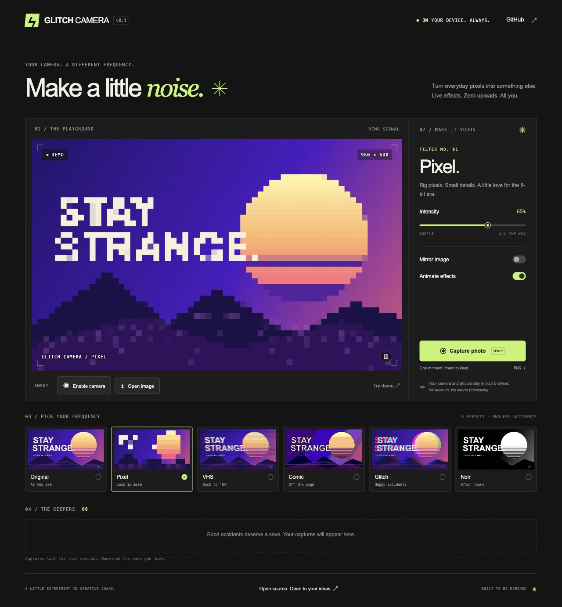

# Glitch Camera ⚡

**Make a little noise.** A free, open source browser camera playground. Turn a webcam feed or a photo into pixel art, a worn-out VHS tape, an inked comic, or a broken signal.



No accounts, image uploads, API keys, or runtime dependencies. Camera access starts only when you click **Enable camera**. You can try every effect with the generated demo instead.

## Try it locally

Install [Node.js](https://nodejs.org/) 20 or later, then:

```sh
git clone https://github.com/pemalama12/glitch-camera.git
cd glitch-camera
npm run dev
```

Open **http://localhost:5173**. There is no `npm install` step. Set `PORT` to use another port. Any static web server can serve `dist/` in production.

## What works today

- Six looks: Original, Pixel, VHS, Comic, Glitch, and Noir.
- Live webcam preview, local image import, and an animated demo.
- Effect intensity, mirroring, animation controls, and pause/resume.
- Capture the displayed frame, then download a 960 × 600 PNG from **The Keepers**.
- Keyboard capture with Space when you are not focused on another control.
- Responsive layout, labeled controls, and reduced-motion preference support.
- Keyboard filter navigation: Left/Right to move between effects, Home/End to jump to the first/last effect.

## Want to help?

This is an early project, and small contributions are welcome: filters, accessibility improvements, browser bug reports, documentation, and design ideas.

- [Find a good first issue](https://github.com/pemalama12/glitch-camera/issues?q=is%3Aissue%20is%3Aopen%20label%3A%22good%20first%20issue%22)
- [Read the contribution guide](CONTRIBUTING.md)
- [Suggest a feature](https://github.com/pemalama12/glitch-camera/issues/new?template=feature_request.yml)

You do not have to write code to help. A clear bug report with a browser version and reproduction steps is useful too. Please use the built-in demo or a non-sensitive sample when sharing screenshots.

## How it works

The app draws a source into an offscreen Canvas, applies a filter to its RGBA pixels, then draws the result into the visible preview. Everything runs on the device. Filters are plain JavaScript functions without DOM dependencies.

```text
dist/
  index.html           Studio interface
  styles.css           Layout and visual design
  app.js               Sources, preview, controls, captures
  effects/index.js     Filter registry and pixel processing
scripts/serve.mjs      Local static server
tests/effects.test.js  Filter contract and edge-case tests
```

Run checks with:

```sh
npm test
node --check dist/app.js
```

## Privacy and current limits

- The app code makes no image uploads, analytics calls, or third-party asset requests. Your hosting provider still receives ordinary requests to load the app files.
- Camera use requires HTTPS or localhost and browser permission. Embedded browsers may block it; open the app in a standalone browser if needed.
- Switching to an image or the demo, pressing **Stop camera**, or leaving the page stops the camera tracks. Pausing the preview freezes the picture; it does **not** disconnect the camera.
- Images are center-cropped to the 8:5 preview frame. Imports are limited to 20 MB and 24 megapixels; animated GIFs are treated as still images.
- Captures live in memory for this session, up to 24 at once. **Save ↓** downloads a capture; clearing the gallery or closing the page discards its in-browser copy.
- Effects use CPU-based Canvas processing at a target of 24 frames per second. Performance varies by device; pausing or disabling animation can help.
- Recording video, audio capture, and selecting different cameras are not implemented yet.

## Roadmap

- Additional community-made filters, starting with duotone.
- Square and portrait capture formats.
- Camera selection and improved mobile camera handling.
- Optional video recording after the capture workflow is stable.

- [x] Keyboard arrow navigation between effects (#2).

## License

[MIT](LICENSE). Build on it, remix it, and share what you make.
